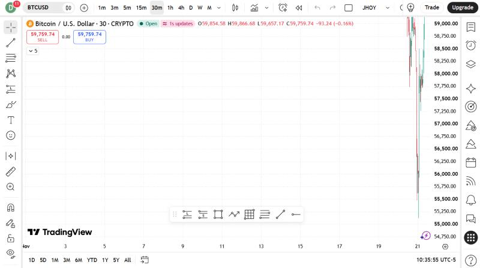
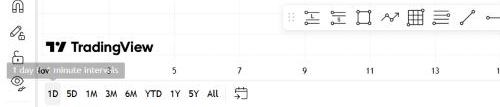
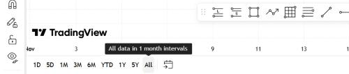
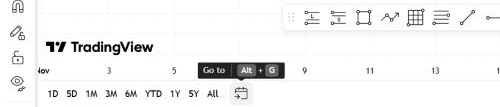
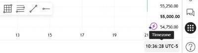
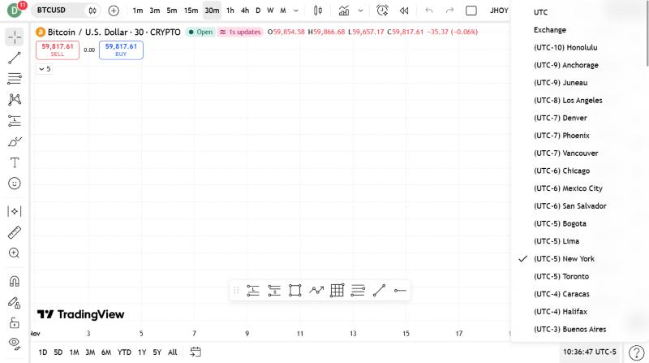
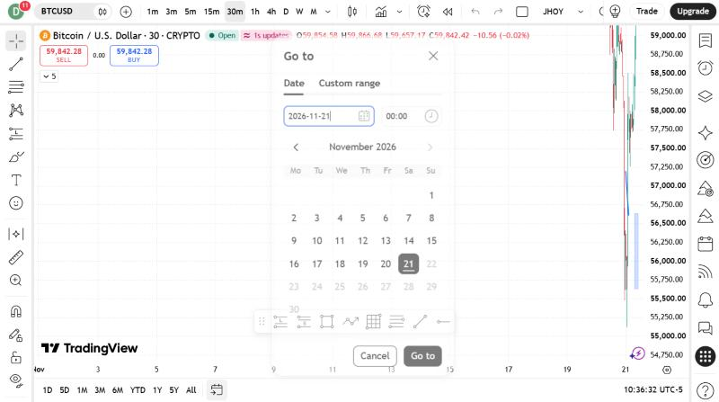
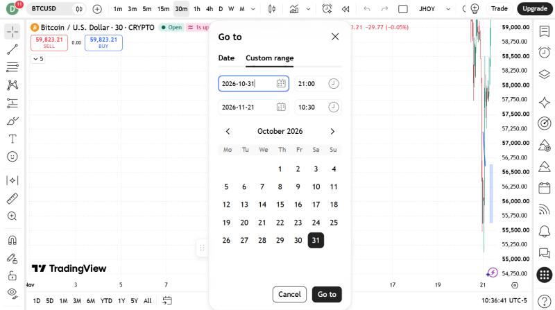
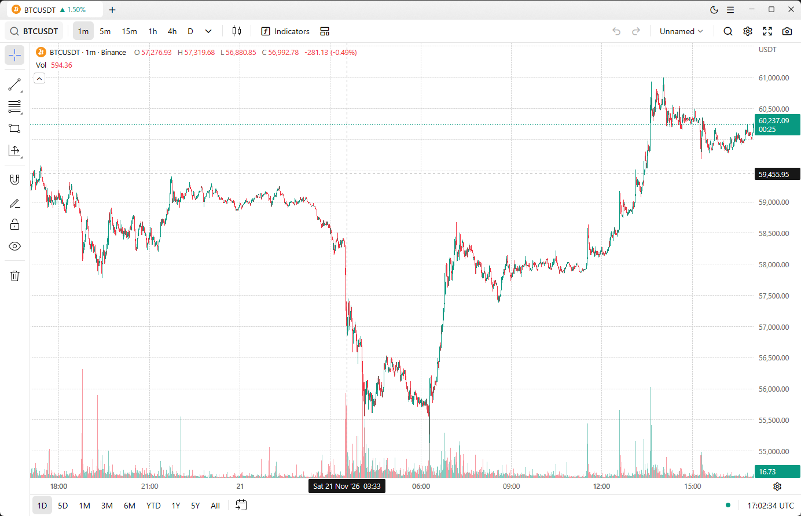
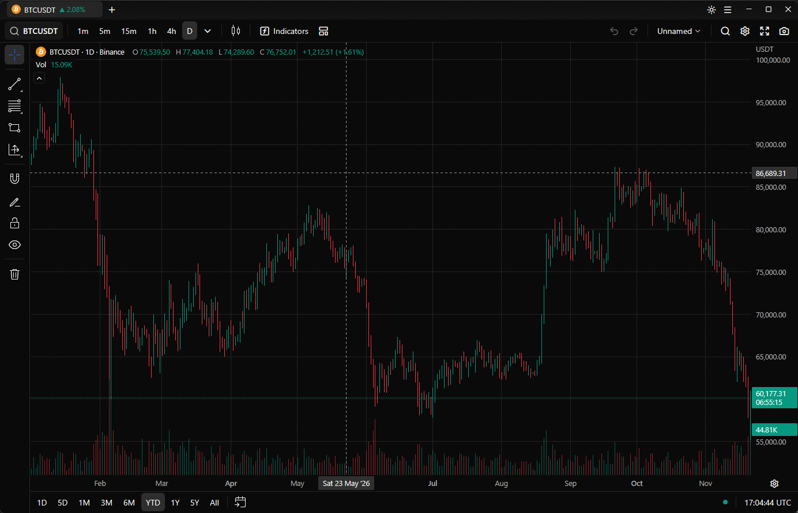

# Bottom toolbar ("down panel")

TradingView's toolbar under the chart, studied on tradingview.com/chart
(signed in, light theme, BTCUSD 30m, 2026-11-21) with the built-in browser:
hover for tooltips, DOM / computed styles read with `getComputedStyle`, Go to
dialog and time zone menu opened and closed with Cancel / Escape. No range
button was clicked and nothing on that chart was changed.

References: `img/tv-ref/tv-bottom-*.png`. Ours: `img/bottom-*.png`.

## TradingView, measured

| | |
|---|---|
| Bar | spans the chart column only (right of the left drawing toolbar, left of the right widget bar); 38 px + 1 px top border; panel background |
| Buttons | full bar height, 14 px text, padding 0 6 px, no gap; hover fill inset 2 px with radius 2; the active range uses the toolbar's *active* state (`isActive`: active text color + fill), like the selected interval on the top bar |
| Groups | ranges, a 22 px vertical divider, Go to icon (28 px icon box, 38 wide); right: the clock |
| Tooltips | above the buttons |
| Narrow window | the ranges collapse into a "Date Range ⌄" menu (`date-ranges-menu`) |

### Controls

| Control | `data-name` | Tooltip (exact) | Behaviour |
|---|---|---|---|
| 1D | `date-range-tab-1D` | 1 day in 1 minute intervals | interval **1m**, last day |
| 5D | `date-range-tab-5D` | 5 days in 5 minutes intervals | **5m**, last 5 days |
| 1M | `date-range-tab-1M` | 1 month in 30 minutes intervals | **30m**, last month |
| 3M | `date-range-tab-3M` | 3 months in 1 hour intervals | **1h**, last 3 months |
| 6M | `date-range-tab-6M` | 6 months in 2 hours intervals | **2h**, last 6 months |
| YTD | `date-range-tab-YTD` | Year to day in 1 day intervals | **1D**, since 1 January |
| 1Y | `date-range-tab-12M` | 1 year in 1 day intervals | **1D**, last 12 months |
| 5Y | `date-range-tab-60M` | 5 years in 1 week intervals | **1W**, last 60 months |
| All | `date-range-tab-ALL` | All data in 1 month intervals | **1M**, everything |
| Go to | `go-to-date` | Go to · Alt + G | opens the Go to dialog |
| Clock | `time-zone-menu` | Timezone | `10:36:28 UTC-5`, live; opens the zone menu (UTC, Exchange, then zones by offset, ✓ on the current one) |

(The interval mapping comes from TradingView's own tooltips; verified by
hovering, not by clicking.)

**Not there any more:** the `%`, `log` and `auto` scale toggles (and
"adj" / session) are gone from today's bottom bar for this symbol; the
scale modes live on the price axis (its context menu and the bottom-right
corner). The settings gear at the right end of the time axis is drawn on
the chart canvas, not part of this toolbar. We already have the price-axis
scale buttons and the chart settings, so neither is added here.

### Go to dialog

- Title "Go to", close ×; 302 px wide.
- Tabs **Date** | **Custom range** (top tabs with underline).
- Date: `YYYY-MM-DD` field (calendar icon) + `HH:MM` field (clock icon),
  default today 00:00; a month calendar below (Monday first, today ringed,
  future days disabled, ‹ › months).
- Custom range: two rows (from, to), defaulting to the chart's visible span
  (e.g. 2026-10-31 21:00 → 2026-11-21 10:30); the calendar edits the
  focused row.
- Footer: Cancel / **Go to**.

## Ours

`crates/tradeterm/src/status_bar.rs` (bar), `go_to.rs` (dialog),
`crates/tt-chart/src/range.rs` (ranges, targets, math, parsing; unit
tested), `ChartView::show_target` in `view.rs`.

- **Layout:** the bar sits under the chart column only (the drawing toolbar
  runs full height beside it), `H_BOTTOM_BAR` = 38 + 1 px top border, panel
  background. Kit `ToolbarButton::text` (32 tall, 14 px, hover / selected
  fills — the same as the top bar's interval buttons), `IconButton` for Go
  to with our 1-stroke `go-to-date` icon, `Divider::vertical()` between
  groups.
- **Ranges:** a click switches the interval as on TradingView
  (`DateRange::timeframe`) and sets a `ViewTarget::Range`. Each frame the
  chart fits `[start, newest bar close]` into the plot
  (`range::fit_span`): calendar months / years in the chart's time zone
  (`DateRange::start`, a month back from 31 March is 28/29 February). If
  the start is older than the first loaded bar the render asks for older
  history (the existing backfill) and re-fits as pages arrive, until the
  start is loaded, the venue has nothing older or the 250 000-bar cap is
  reached (`TabSource::rendered` settles it). All loads until exhausted.
- **Highlight:** the clicked range shows selected until the user zooms or
  scrolls (the view's spacing / offset differ from what the target left) or
  changes the interval (`reset_view`). Live ticks keep it.
- **Go to (Alt+G):** comfortable kit dialog, tabs Date | Custom range,
  kit `Field`s, gpui-component `Calendar` (Monday first, future days
  disabled), footer Cancel / Go to, Enter submits, errors inline. Times are
  read in the chart's time zone. Date centers the bar at that time keeping
  the zoom; Custom range fits the span. Both load history first if needed.
- **Clock:** the existing live clock and zone menu moved to the right end
  (tooltip "Timezone" like TradingView, same 32 px button as the rest).

### The old status bar items

TradingView's bar has none of them, so we keep only what does not
duplicate the chart and is useful on its own:

| Item | Decision |
|---|---|
| Connection | **kept, minimal:** a status dot left of the clock (tooltip "Connected · Binance"); words ("Connecting…", "Disconnected") only while not connected. TradingView signals a lost connection too, and our data source is otherwise not visible. |
| Last price | **dropped:** the price axis tag and the legend OHLC already show it. |
| Bars | **dropped:** a developer number; it stays in the F12 performance overlay. |
| Base / quote, Tick | **dropped:** the legend shows the symbol; tick size is in Symbol info / settings. |
| Source name | folded into the connection dot's tooltip. |

### Not done / later

- TradingView collapses the ranges into a "Date Range" menu on narrow
  windows; ours keep the buttons (the chart column is wide enough at our
  minimum window size).
- Range targets on Renko / Line break charts fit their brick series, not
  calendar time.
